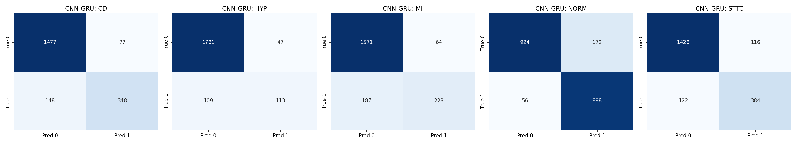

# PTB-XL ECG Classification

Multi-label classification of 12-lead ECGs into five diagnostic superclasses on the public [PTB-XL dataset](https://physionet.org/content/ptb-xl/1.0.3/), comparing a classical SVM baseline with a 1D-CNN and a hybrid CNN-GRU. The whole pipeline (download, preprocessing, training, evaluation) runs from one notebook, `PTB-XL_dataset_v4.ipynb`, in Google Colab.

## Results

Held-out test fold (fold 10), single seeded run (seed 42).

| Model | Micro F1 | Macro F1 | Macro AUC |
|:--|:--:|:--:|:--:|
| SVM on 48 handcrafted features | 0.5985 | 0.4869 | 0.8246 |
| 1D-CNN | 0.7839 | 0.7226 | 0.9300 |
| CNN-GRU | 0.7821 | 0.7286 | 0.9304 |

- F1 uses a fixed decision threshold (0.5 on sigmoid outputs for the networks, 0 on the decision function for the SVM). Macro AUC does not depend on a threshold. Macro means the unweighted average over the five classes.
- Both networks improve on the SVM by about +0.24 macro F1 and +0.11 macro AUC.
- The 1D-CNN and the CNN-GRU are indistinguishable in this single run (differences of at most 0.006 in F1 and 0.0004 in AUC), so no claim is made that one is better.
- For context, published PTB-XL benchmark results for ResNet-style CNNs on the superclass task are around 0.92-0.93 macro AUC ([Strodthoff et al., 2021](https://doi.org/10.1109/JBHI.2020.3022989)). The numbers here fall in that range, but the protocols are not identical (see Limitations), so treat this as a sanity check, not a leaderboard comparison.

Per-class F1 and AUC are in `results/results_per_class.csv`, and the epoch-by-epoch training log is in `results/training_log.csv`.

## Task and data

- **Dataset:** PTB-XL v1.0.3, 21,799 ten-second 12-lead ECG records from 18,869 patients. The 100 Hz version is used (1000 samples per lead).
- **Targets:** five diagnostic superclasses: CD (conduction disturbance), HYP (hypertrophy), MI (myocardial infarction), NORM (normal ECG) and STTC (ST/T change).
- **Labels:** the problem is multi-label, since one record can carry several superclasses. A superclass is positive when any SCP statement mapped to it has likelihood >= 50. Records with no superclass label are dropped.
- **Splits:** the dataset's recommended stratified folds. Folds 1-8 are used for training, fold 9 for validation and fold 10 for testing. All records of one patient fall in the same fold, and the notebook prints the number of patients shared between the training and test folds as a check.

## Pipeline

**Preprocessing.** NaN values (if any) are set to 0, then each lead is filtered with a 0.5-49.9 Hz, 4th-order Butterworth band-pass applied forwards and backwards (zero phase) to remove baseline wander and high-frequency noise. The upper edge stays just below the 50 Hz Nyquist frequency. No other normalisation is applied.

**Models**

1. **SVM baseline.** 48 features per record (mean, variance, skewness and mean spectral energy for each of the 12 leads), mean imputation and standardisation fitted on the training set only, then a one-vs-rest RBF-kernel SVC (C = 1).
2. **1D-CNN.** Four blocks of convolution, batch normalisation, ReLU and max-pooling (kernel sizes 15, 11, 7 and 5; 32, 64, 128 and 256 channels), followed by global average pooling and a linear layer on the raw filtered signals.
3. **CNN-GRU.** A shallow CNN (three blocks, kernel sizes 15, 7 and 5; 32, 64 and 128 channels) compresses 1000 time steps to 125. A 2-layer bidirectional GRU (hidden size 128, dropout 0.2) follows, then max-pooling over time and a linear layer.

**Training.** Binary cross-entropy with logits, AdamW (learning rate 1e-3, weight decay 1e-4), batch size 64 and 10 epochs. The checkpoint with the lowest validation loss is kept. The test fold is used once per model, at the end. Seeds are fixed to 42 and cuDNN is set to deterministic mode, but GPU runs can still differ slightly.

## Reproduce

1. Click the **Open in Colab** badge above.
2. Choose Runtime > Change runtime type > **T4 GPU**.
3. Choose Runtime > **Run all**. It takes roughly 15-30 minutes on a T4, including the 1.7 GB dataset download.
4. At the end the notebook saves its outputs to `results/` and downloads them as `results.zip`.

Package versions from the run that produced the results above are pinned in `requirements.txt`.

## Repository contents

| Path | Description |
|:--|:--|
| `PTB-XL_dataset.ipynb` | Full pipeline: data loading, preprocessing, SVM, 1D-CNN, CNN-GRU, evaluation |
| `results/results.csv` | Summary metrics (the table above) |
| `results/results_per_class.csv` | Per-class F1 and AUC for each model |
| `results/training_log.csv` | Training and validation loss per epoch |
| `results/confusion_matrices_cnn_gru.png` | Per-class confusion matrices for the CNN-GRU |
| `requirements.txt` | Pinned package versions |

## Limitations

- **Single run.** One seed, no confidence intervals or repeated runs, so small differences between the two networks are not meaningful.
- **One test fold.** Fold 10 only, with no cross-validation across folds.
- **Not directly comparable to published numbers.** Labels use a likelihood threshold of 50 and records without a superclass label are dropped, which differs from the label aggregation used in the published benchmark. Models are small and trained for only 10 epochs, with no hyperparameter search.
- **Fixed threshold.** F1 is computed at 0.5 for all classes, without per-class threshold tuning.
- **Superclass level only,** at 100 Hz, on a single dataset with no external validation.
- **ECG waveforms, not EHR data.** This is a learning and portfolio project and is not intended for clinical use.

## Data and references

- Wagner, P., Strodthoff, N., Bousseljot, R.-D., et al. *PTB-XL, a large publicly available electrocardiography dataset.* Scientific Data 7, 154 (2020). https://doi.org/10.1038/s41597-020-0495-6
- Strodthoff, N., Wagner, P., Schaeffter, T., Samek, W. *Deep Learning for ECG Analysis: Benchmarks and Insights from PTB-XL.* IEEE Journal of Biomedical and Health Informatics 25(5), 2021. https://doi.org/10.1109/JBHI.2020.3022989
- Goldberger, A. L., et al. *PhysioBank, PhysioToolkit, and PhysioNet.* Circulation 101(23), e215-e220 (2000).

The PTB-XL data is distributed through PhysioNet under its own open-access licence. Please cite the references above if you reuse the data.
